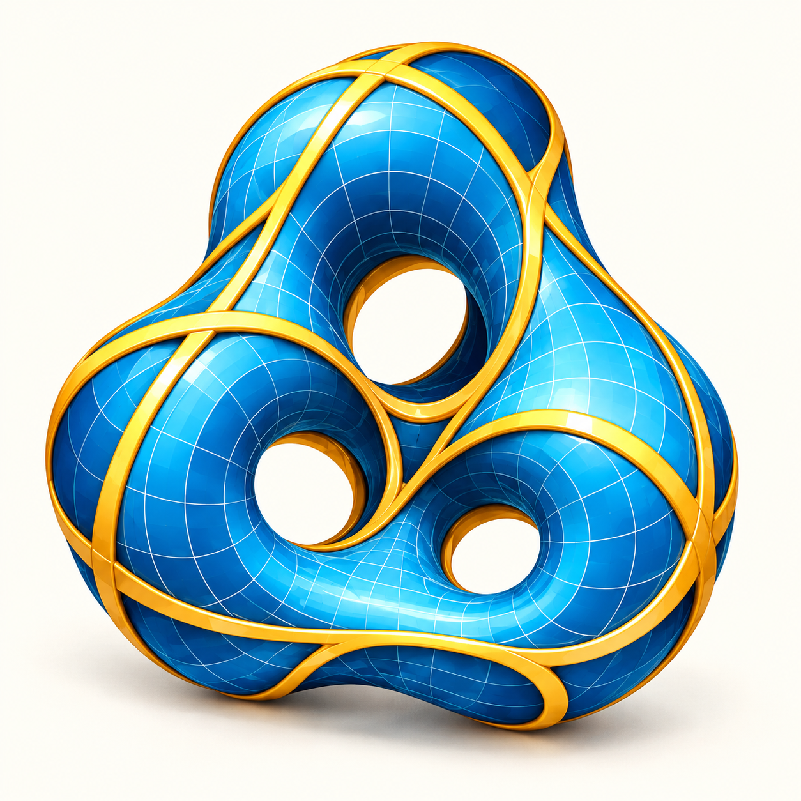
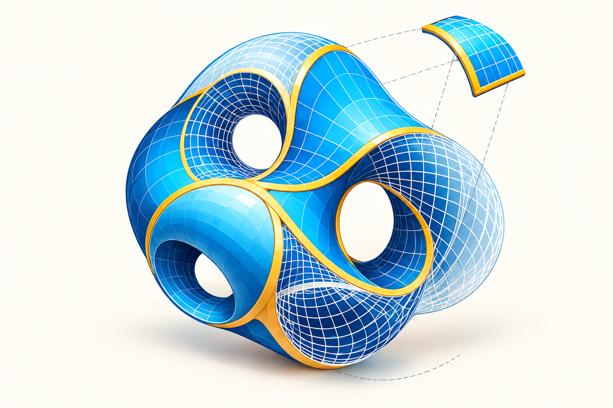
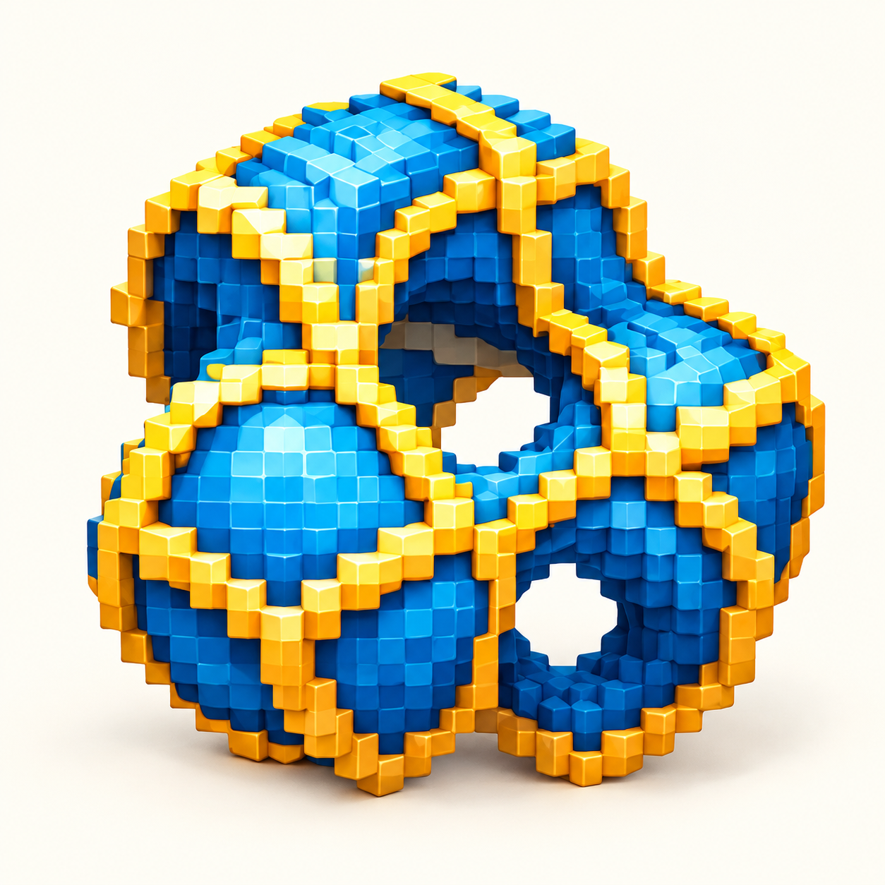

Small decisions behind the models, visuals and tools on this site.

Making notes · November 1, 2026

<a href="#recovering">01 / Recovering a model</a><a href="#smoothing">02 / Smoothing with restraint</a><a href="#identity">03 / A geometric identity</a>

<article class="making-note" id="recovering">
ARCHIVES & GEOMETRY
<h2>Recovering a surface from a MATLAB figure</h2>
The first website export used the solid element set of an archived INP file. That surface contained 44 disconnected pieces. A saved MATLAB figure retained a different, continuous structural visualization: 41,041 vertices and 76,849 triangles in one connected surface.

Its two graphics objects were identical, so only one was exported. Reversing the saved plot’s Z direction aligned its vertices with the original design mesh. This recovered geometry now powers the branching-shell viewer.
<a href="/models/">Inspect the actual model →</a></article>
<article class="making-note" id="smoothing">
VISUALIZATION
<h2>Smoother edges, the same connectivity</h2>
A triangle mesh can make a curved boundary look like a staircase. The display version gently moves boundary vertices along the surface, blending the adjustment into two neighboring rings. Junctions remain pinned, and movement is limited to one median mesh edge.

The connectivity and openings are retained. Surface area changes by about 0.16%; the largest vertex movement is about 0.25% of the bounding-box diagonal. This is a visual treatment, not a newly validated analysis mesh. Both versions are available in the viewer.
<a href="/assets/models/tee-processed.glb" download>Unsmoothed archive →</a></article>
<article class="making-note" id="identity">
DESIGN
<h2>One palette, three geometric voices</h2>

Lake blue and golden yellow connect the three emblems: a multi-hole shell for the avatar, a surface atlas for the homepage, and a pixel structure for the playground. Curved surfaces, reinforcing lines and visible openings echo the research themes.

These AI-assisted illustrations are conceptual identity artwork. The research gallery uses archived mesh data.
</article>