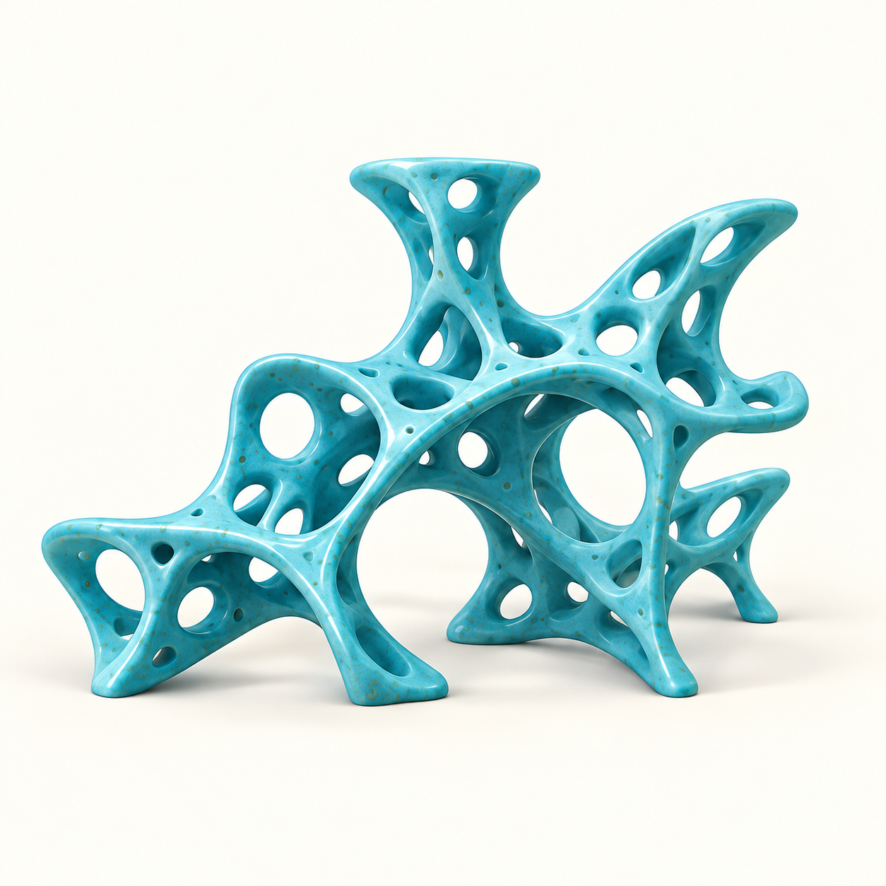

Real meshes from my research archive. Rotate, compare and inspect the geometry.
<a href="/visual-diary/">Visit the visual diary →</a>
<figure><figcaption>Concept illustration</figcaption></figure>

<button type="button" data-gallery="tee" aria-pressed="true">01 / Branching shell</button><button type="button" data-gallery="torus" aria-pressed="false">02 / Torus shell</button>

Tee-branch shell · Recovered from an archived MATLAB figure, with a lightly smoothed display version.

<section class="surface-explorer" aria-labelledby="interactive-surface-title">
  

EXPLORE THE GEOMETRY
<h2 id="interactive-surface-title">Explore a branching shell in 3D.</h2>
<a href="{{ '/assets/models/tee-smoothed.glb' | relative_url }}" download>Download display model · GLB</a>

  
An archived topology-optimization result on a tee-branch shell: connected members and open regions follow the branching curved surface. Compare the optimized layout with its original design surface, and rotate to inspect the geometry.

  

    
↻
Explore the optimized tee-branch in 3D
<button type="button" class="load-surface" hidden>Load interactive model</button><noscript>
Enable JavaScript to rotate the model, or download the GLB above.
</noscript>

    
<button type="button" class="show-optimized" aria-pressed="true">Smoothed display</button><button type="button" class="show-raw" aria-pressed="false">Archived mesh</button><button type="button" class="show-original" aria-pressed="false">Original surface</button><button type="button" class="rotate-surface" aria-pressed="true">Pause rotation</button><button type="button" class="reset-surface">Reset view</button>

    

  

  
Lightly smoothed for display · Original connectivity and openings retained. Compare with the archived mesh to inspect the unchanged structural layout. <a href="{{ '/assets/models/tee-processed.glb' | relative_url }}" download>Download unsmoothed archive ↗</a>

</section>
<article>
01 / BRANCHING SHELL
<h2>From archive to interaction</h2>
A continuous 76,849-triangle surface recovered from a saved structural visualization. The display smoothing preserves connectivity; the archived geometry is available for comparison.
<a href="/field-notes/#recovering">Read the recovery note →</a></article><article>
02 / TORUS SHELL
<h2>Topology around a loop</h2>
An archived iteration 310, showing 22,690 triangles from the explicitly solid element set. Void and transition elements are omitted. This is an intermediate archive, not a claim of final convergence.
<a href="/assets/models/torus-optimized.glb" download>Download archived GLB →</a></article>
