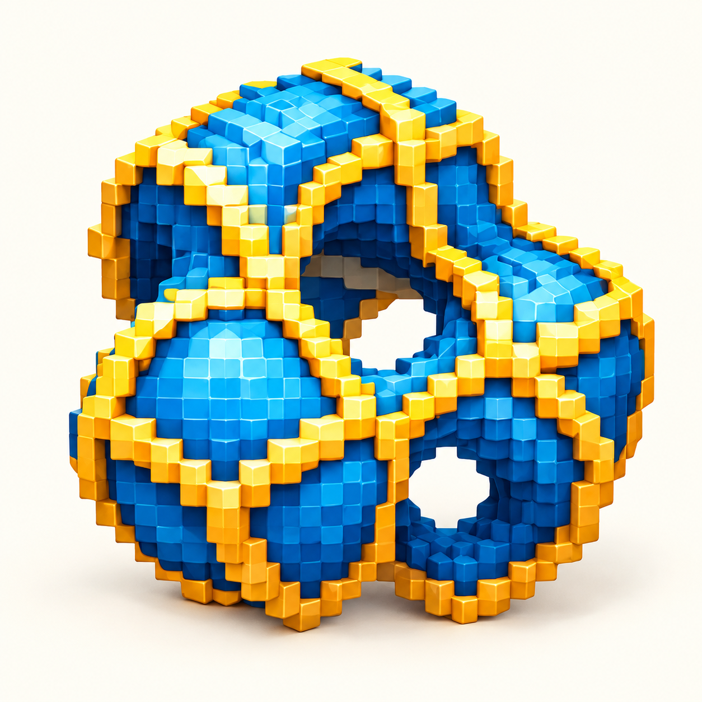

A LITTLE ROOM TO PLAY
<h2>Follow a curve.</h2>
Turn a few knobs. Find an unexpected pattern. Take it home.

<section class="curve-lab" aria-label="Interactive curve studio">
<label>Pattern<select id="curve-type"><option value="lissajous">Lissajous</option><option value="rosette">Rosette</option></select></label><label>Frequency A <output id="a-value">3</output><input id="curve-a" type="range" min="1" max="12" value="3"></label><label>Frequency B <output id="b-value">4</output><input id="curve-b" type="range" min="1" max="12" value="4"></label><label>Phase <output id="phase-value">45°</output><input id="curve-phase" type="range" min="0" max="180" value="45"></label><label>Palette<select id="curve-palette"><option value="blue">Lake & lemon</option><option value="coral">Coral & ink</option><option value="mint">Mint & violet</option></select></label>
<svg id="curve-art" viewBox="0 0 800 600" role="img" aria-label="Generated parametric curve"></svg>
<button id="curve-random" type="button">Surprise me</button><button id="curve-reset" type="button">Reset</button><button id="curve-download" type="button">Download SVG ↓</button>

<noscript>Enable JavaScript to draw and export your pattern.</noscript></section>

A mathematical drawing toy. All pattern generation happens in your browser.
