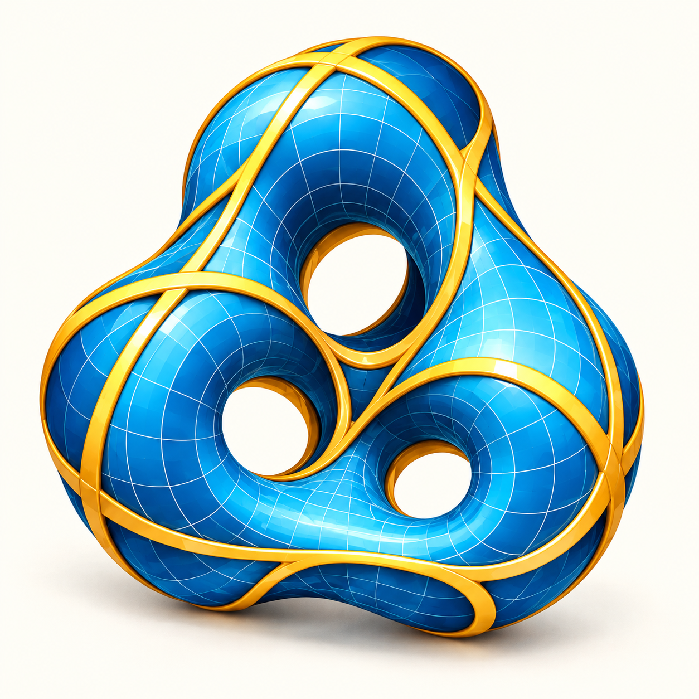
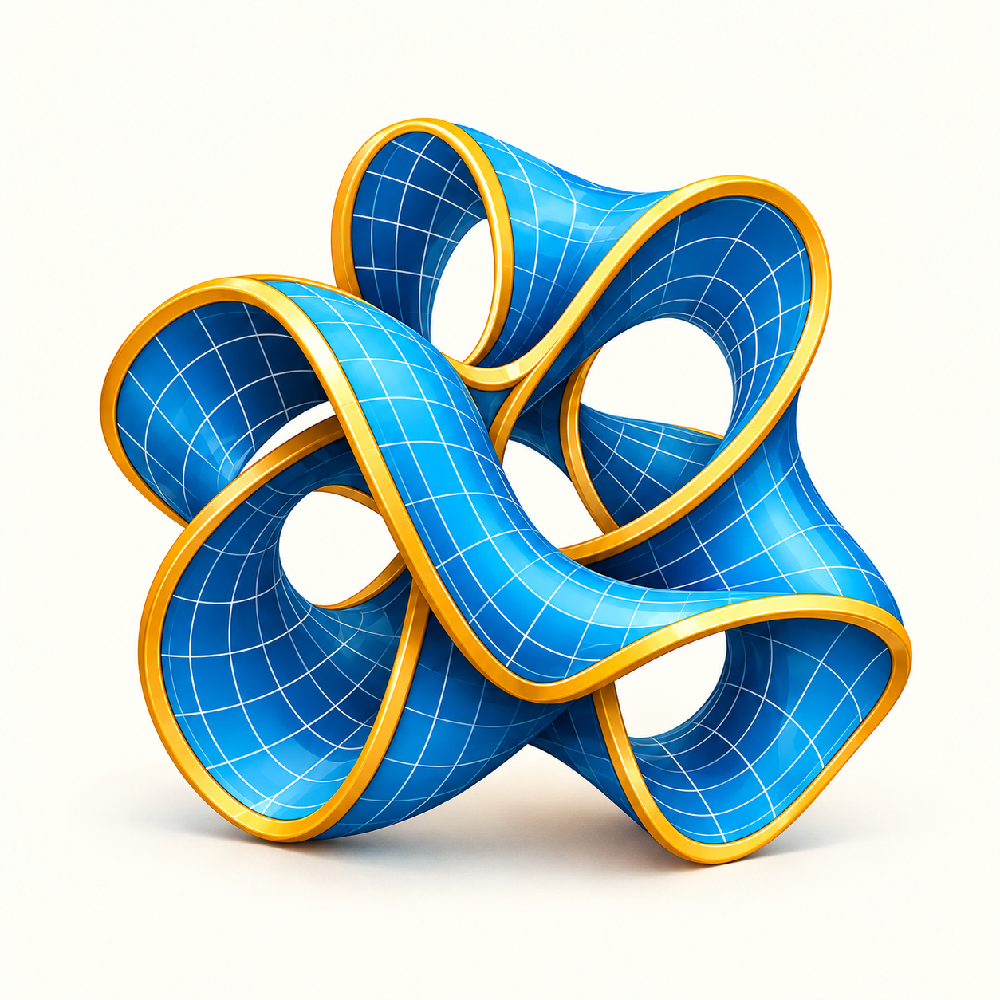
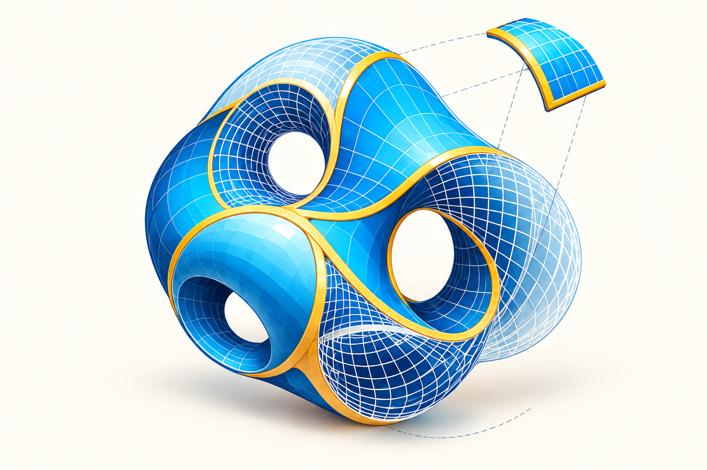
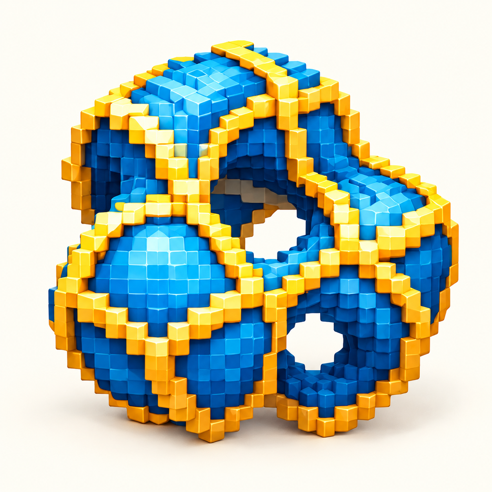
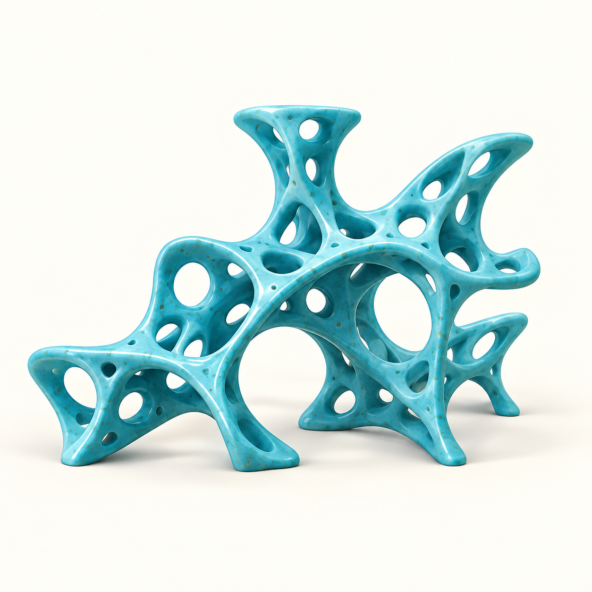
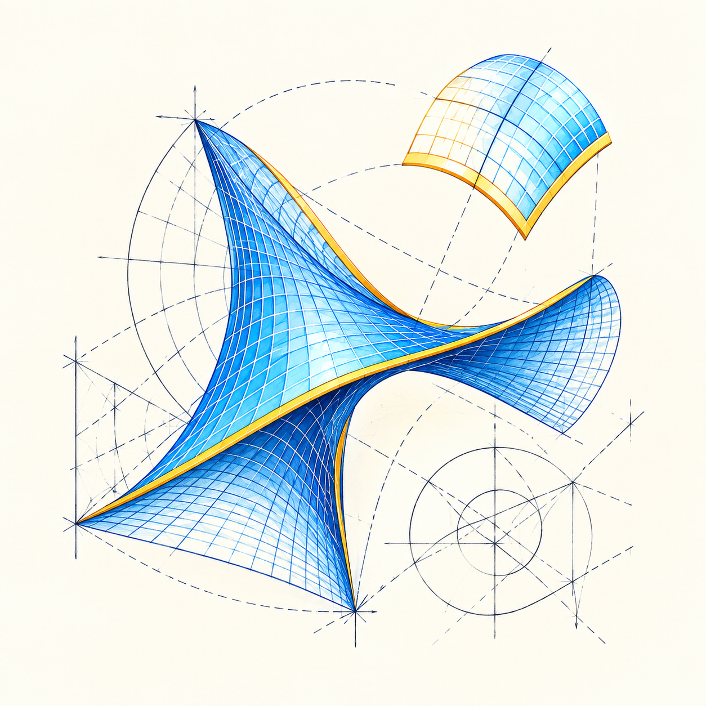
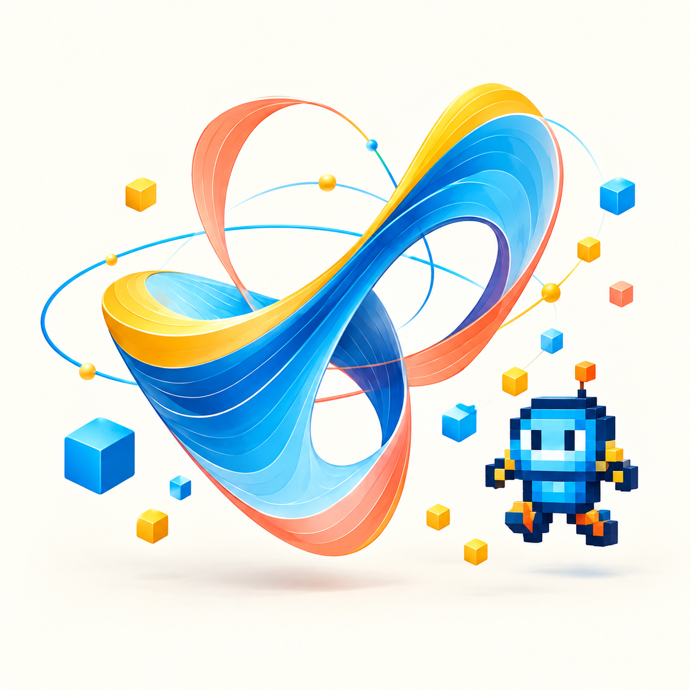
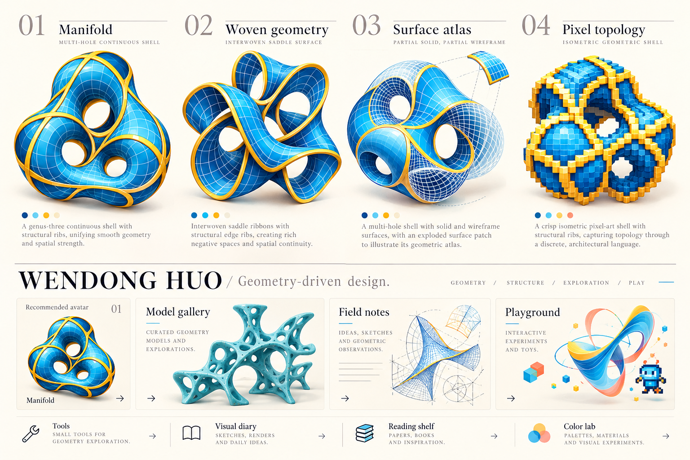

A collection of surfaces, sketches and small visual experiments.

AI-assisted concept artwork developed from the website design board. These images are visual studies, not computed structures or analysis results.

<figure id="manifold"><figcaption><h2>01 / Manifold</h2>
A continuous shell, drawn as a personal emblem.
</figcaption></figure>
<figure id="woven"><figcaption><h2>02 / Woven geometry</h2>
Interwoven saddle ribbons and golden edges. A companion to the manifold.
</figcaption></figure>
<figure id="atlas"><figcaption><h2>03 / Surface atlas</h2>
Solid, wireframe and an exploded patch: different ways of seeing a surface.
</figcaption></figure>
<figure id="pixel"><figcaption><h2>04 / Pixel topology</h2>
The same curiosity, expressed through small discrete blocks.
</figcaption></figure>
<figure id="gallery"><figcaption><h2>Porous structures</h2>
An imagined lattice sculpture; a visual doorway into the real model archive.
</figcaption></figure>
<figure id="notes"><figcaption><h2>On the drawing board</h2>
Curved patches, construction lines and room for another idea.
</figcaption></figure>
<figure id="play"><figcaption><h2>A little adventure</h2>
Ribbons, orbiting cubes and a pixel explorer for the playful side of geometry.
</figcaption></figure>

<section class="color-lab" id="color-lab" aria-labelledby="color-title">
A PALETTE TO PLAY WITH
<h2 id="color-title">Lake blue. Golden edges. Your variation.</h2>
Try a different balance of surface, edge and paper. This experiment only changes the preview below.

<label>Surface <input id="color-surface" type="color" value="#087eae"></label><label>Edge <input id="color-edge" type="color" value="#e8b928"></label><label>Paper <input id="color-paper" type="color" value="#faf9f4"></label>

<button id="palette-reset" type="button">Reset blue & gold</button><button id="palette-download" type="button">Download palette · SVG ↓</button><noscript>Enable JavaScript to preview and download a custom palette.</noscript></section>

The original design board

<a href="/models/">Explore real research meshes →</a> · <a href="/playground/">Try the interactive geometry →</a>

